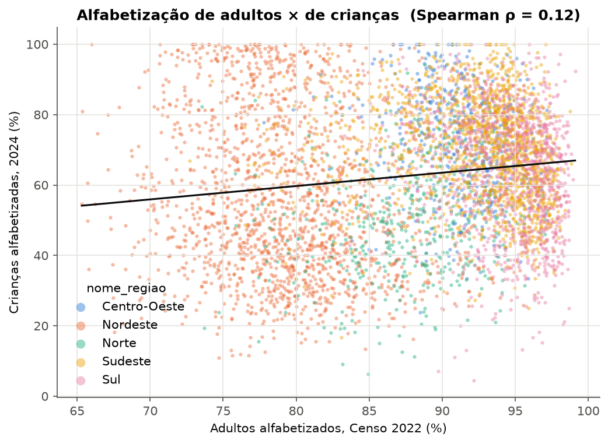
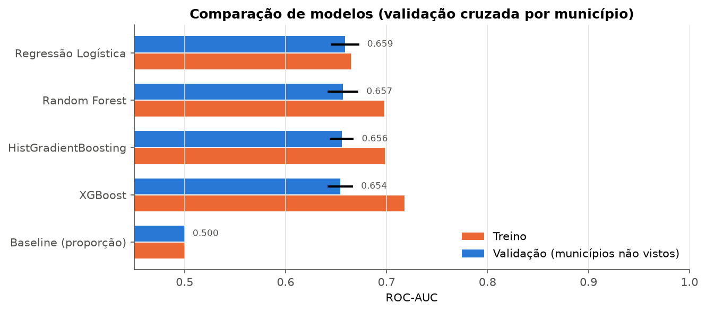
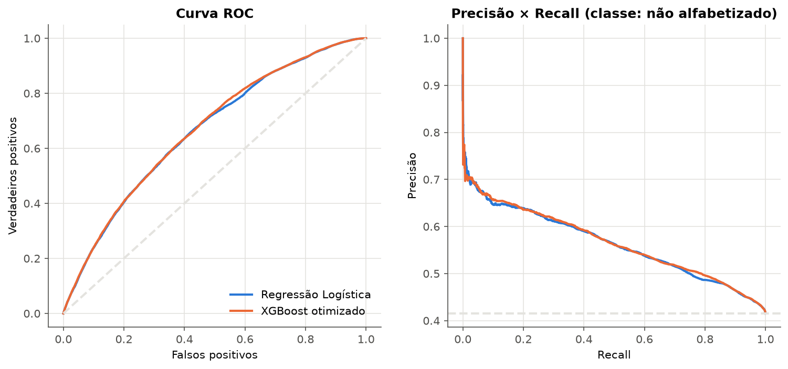
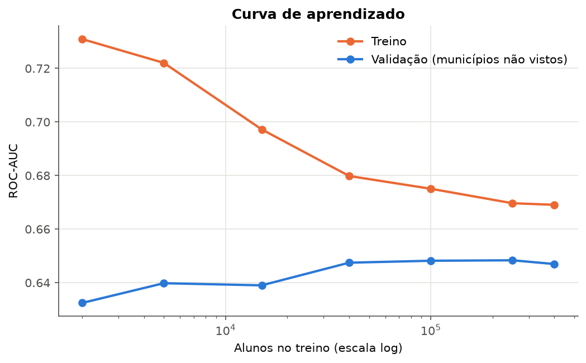
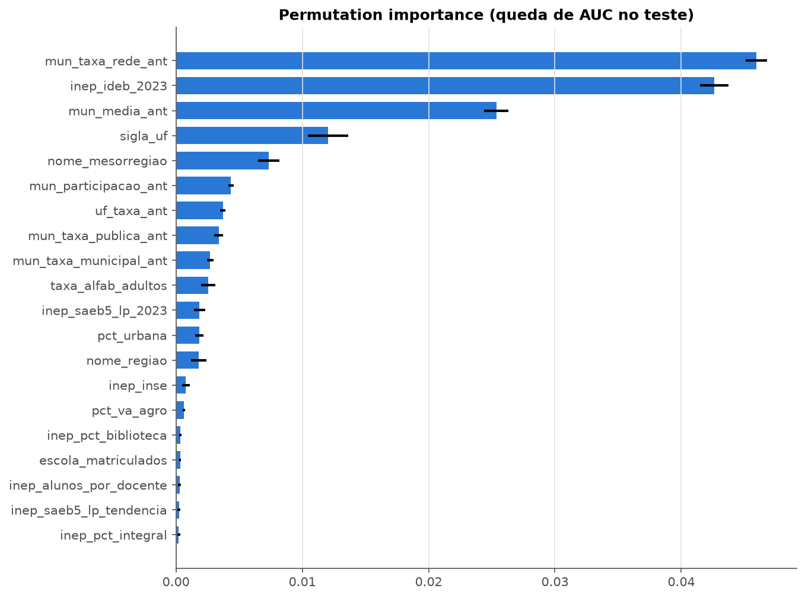
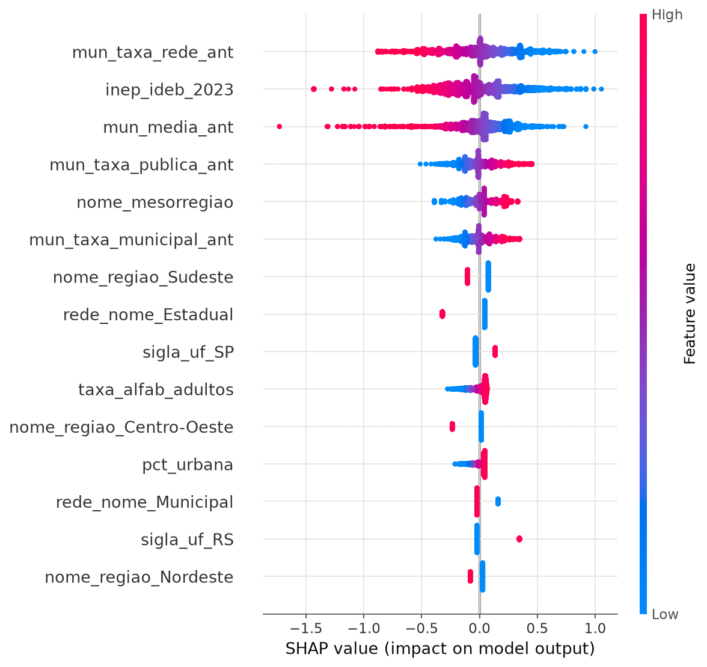
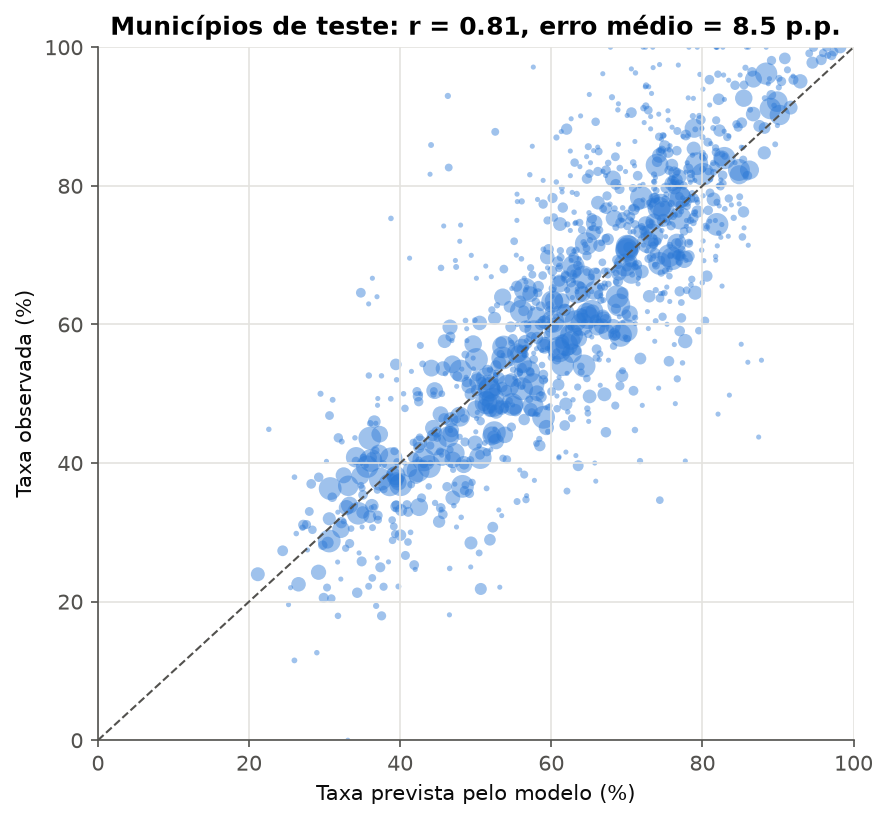
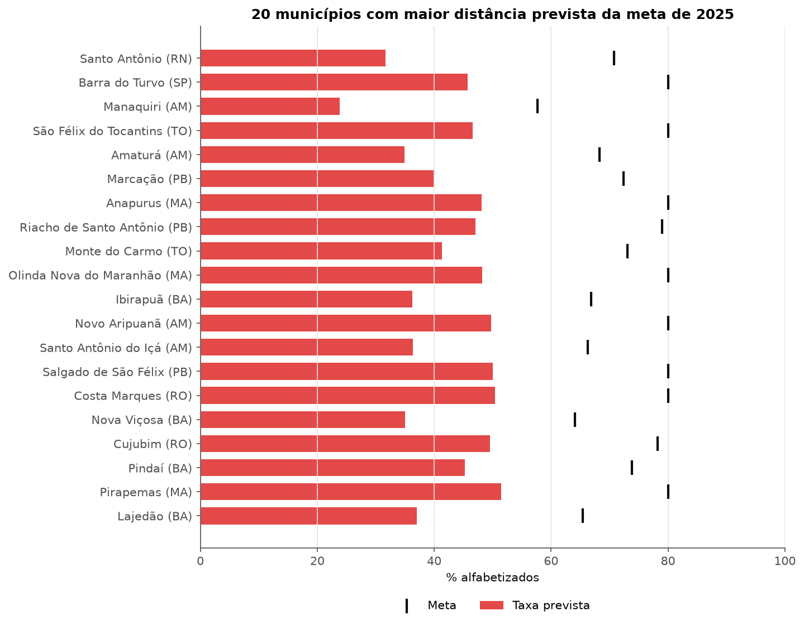
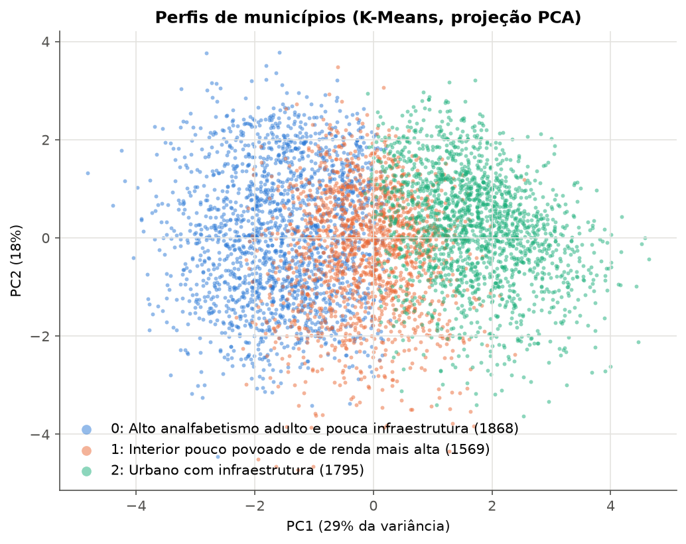
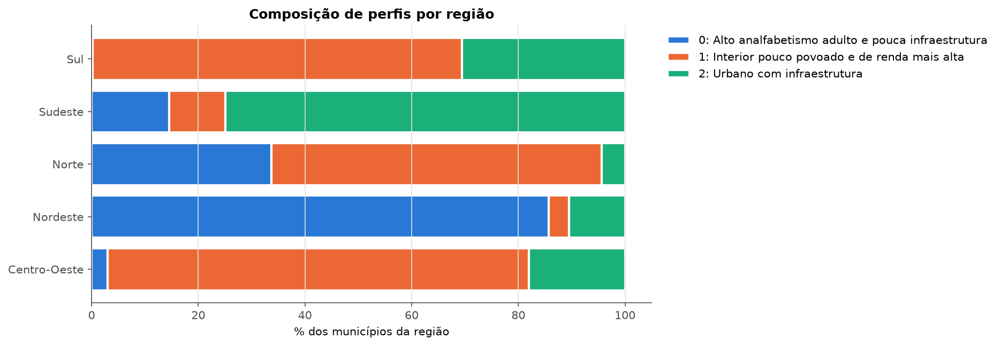

# Predição e inteligência analítica para alfabetização no Brasil

Tech Challenge Fase 3 — Pós Tech AI Scientist

Este projeto usa a camada Gold da Fase 2 para estimar, para cada aluno do 2º ano da rede pública,
a chance de ele não se alfabetizar, usando só o que já se sabia antes da prova. Depois as previsões
são juntadas por município para apontar quem corre risco de não bater a meta de 2025, e os
municípios são agrupados por perfil.

A Gold vem do projeto da Fase 2
([eriicpa/tech_challenge_2_pipeline_dados](https://github.com/eriicpa/tech_challenge_2_pipeline_dados)).
Junto com ela entram dados do IBGE e do Inep (Censo Escolar, Saeb do 5º ano, Ideb e Inse).

---

## Apresentação

[](https://youtu.be/g187S1yGc1Y)

- Vídeo executivo (5 min): [YouTube](https://youtu.be/g187S1yGc1Y) · cópia em [reports/video_apresentacao.mp4](reports/video_apresentacao.mp4)
- Slides: [reports/apresentacao.pdf](reports/apresentacao.pdf)

---

## Sumário

- [Apresentação](#apresentação)
- [Estrutura do repositório](#estrutura-do-repositório)
- [Contexto do problema](#contexto-do-problema)
- [Objetivo analítico](#objetivo-analítico)
- [Base de dados](#base-de-dados)
- [Análise exploratória](#análise-exploratória)
- [Etapas de modelagem](#etapas-de-modelagem)
- [Escolha do algoritmo](#escolha-do-algoritmo)
- [Decisões e trade-offs](#decisões-e-trade-offs)
- [Métricas de avaliação](#métricas-de-avaliação)
- [Interpretação dos resultados](#interpretação-dos-resultados)
- [Aplicação estratégica](#aplicação-estratégica)
- [Insights encontrados](#insights-encontrados)
- [Aplicação prática para políticas públicas](#aplicação-prática-para-políticas-públicas)
- [Como rodar](#como-rodar)
- [Resultados da última execução](#resultados-da-última-execução)
- [Limitações](#limitações)
- [Evoluções futuras](#evoluções-futuras)
- [Versionamento](#versionamento)
- [Fontes](#fontes)

---

## Estrutura do repositório

```
tech_challenge_3/
├── data/
│   ├── gold/                 exportação da Gold (fora do Git, ver data/README.md)
│   ├── external/             IBGE, metas e dados das escolas do Inep
│   └── processed/            divisão treino/teste por município
├── databricks/
│   └── exportar_gold_fase3.py           cria a gold_aluno_ml e exporta a Gold
├── notebooks/
│   ├── 01_analise_exploratoria.ipynb    análise exploratória e hipóteses
│   ├── 02_modelagem.ipynb               comparação de modelos, Optuna e métricas
│   ├── 03_interpretabilidade.ipynb      permutation importance e SHAP
│   └── 04_aplicacao_estrategica.ipynb   municípios, projeção 2025 e K-Means
├── src/
│   ├── config.py             caminhos, anos, variáveis e colunas bloqueadas
│   ├── pipeline.py           treino completo, de ponta a ponta
│   ├── data/                 leitura da Gold e das fontes externas
│   ├── preprocessing/        montagem da base e pipeline de variáveis
│   ├── modeling/             treino, validação, Optuna, municípios, agrupamento
│   ├── evaluation/           métricas
│   └── visualization/        gráficos
├── tests/                    testes contra vazamento de dados
├── reports/                  resultados, rankings, slides e vídeo da apresentação
├── images/                   gráficos
├── requirements.txt
└── README.md
```

Na Fase 2 os notebooks eram .py do Databricks. Aqui são .ipynb, porque os gráficos e as tabelas
precisam aparecer já executados no GitHub. O treino pesado fica em src/pipeline.py e os notebooks só
carregam o modelo salvo, então dá para abrir e ler sem esperar nada rodar.

---

## Contexto do problema

O Compromisso Nacional Criança Alfabetizada quer que toda criança esteja alfabetizada até o fim do
2º ano. O Inep considera alfabetizado quem tira 743 pontos ou mais na prova de leitura do Saeb, e
cada município tem uma meta para cada ano, chegando a 80% em 2030.

Em 2024, 59% das crianças da rede pública estavam alfabetizadas, e 47% dos municípios ficaram
abaixo da própria meta. O problema é que o resultado só sai uma vez por ano, meses depois da prova.
Quando o gestor descobre que ficou para trás, o ano letivo já acabou. A ideia aqui é dar esse sinal
antes.

### Por que não era simples

**A resposta estava dentro da base.** O rótulo sai direto da nota de 2024, e a Gold tem várias
colunas calculadas com essa mesma prova, como a taxa do ano e a distância até a meta. Qualquer uma
delas daria um modelo ótimo no papel e inútil na prática, porque na hora de usar essa informação
ainda não existe.

**O código da escola é fictício e muda todo ano.** Para proteger as crianças, o Inep troca o código
real da escola por um sorteado. Dos códigos que aparecem nos dois anos, só 2,4% ficam no mesmo
município. Ou seja, não dá para montar histórico de escola, e a escola só vale dentro do próprio
ano.

**A meta de 2025 é outra conta.** A meta de 2024 ficava no máximo 7 pontos acima da taxa anterior
do município. A de 2025 chega a 69 pontos acima. Um modelo treinado direto em "bateu ou não a meta
de 2024" não serve para 2025.

---

## Objetivo analítico

1. Prever se um aluno vai ou não se alfabetizar, com informações educacionais, territoriais e
   socioeconômicas disponíveis antes da prova.
2. Transformar essas previsões numa estimativa por município e na chance de cada um não atingir a
   meta, inclusive em anos futuros.
3. Entender quais fatores mais pesam, com Feature Importance e SHAP.
4. Agrupar municípios parecidos para pensar políticas por perfil.

O modelo procura os alunos que **não** vão se alfabetizar, porque são esses que a política precisa
encontrar.

---

## Base de dados

### Camada Gold (Fase 2)

| Tabela | Uma linha por | Linhas | Para quê |
|---|---|---|---|
| gold_aluno_ml | aluno e ano | 3.867.999 | o resultado de cada aluno, com escola e município |
| gold_indicador_municipio | município, rede e ano | 23.995 | histórico do município, metas, território |
| gold_ranking_uf, gold_evolucao_temporal e outras | UF ou município | | análise exploratória |

A Gold da Fase 2 só tinha dados agregados por município. Como o modelo precisa de uma linha por
aluno, publiquei a tabela de alunos da Silver (fato_aluno) como gold_aluno_ml, em
[databricks/exportar_gold_fase3.py](databricks/exportar_gold_fase3.py). Os arquivos exportados
estão descritos em [data/README.md](data/README.md).

### Fontes externas

| Informação | Fonte |
|---|---|
| população, densidade, % urbana, adultos alfabetizados, esgoto | IBGE, Censo 2022 |
| PIB per capita, peso da agropecuária | IBGE, PIB dos Municípios 2021 |
| metas até 2030 | Inep, o mesmo arquivo usado na Fase 2 |
| nota do 5º ano (2019, 2021, 2023), Ideb e aprovação 2023 | Inep, Ideb por escola |
| nível socioeconômico dos alunos de cada escola | Inep, Inse 2023 |
| tempo integral, biblioteca, internet, alunos por turma, % rural | Inep, Censo Escolar 2023 |

O IBGE é baixado pela API SIDRA ([src/data/externos_ibge.py](src/data/externos_ibge.py)) e o Inep
pelos arquivos públicos ([src/data/externos_inep.py](src/data/externos_inep.py)). Não usei nada do
Inep depois de 2023: o arquivo do Ideb é a edição 2025, e as colunas de 2025 são descartadas.

### Por que os dados das escolas entram por município

A ideia inicial era ligar cada aluno à escola dele no Censo, no Saeb e no Inse. Só que, na base de
alunos, o código real da escola vira um código fictício (60000001, 60000002...). Daria para tentar
descobrir qual escola é qual cruzando município e número de alunos, mas isso seria passar por cima
de uma proteção dos dados das crianças, e não fiz.

O que fiz foi juntar os dados das escolas por município e rede. Por exemplo: a nota média do 5º ano
das escolas municipais de cada cidade. Essas variáveis começam com inep_ no código.

### Recorte

Rede pública (estadual e municipal), 2º ano, alunos que fizeram a prova. Os dados de 2023 servem de
histórico e os de 2024 são o que o modelo prevê. Na projeção, 2024 vira o histórico para prever
2025.

---

## Análise exploratória

Notebook: [01_analise_exploratoria.ipynb](notebooks/01_analise_exploratoria.ipynb)

O que encontrei e o que isso mudou no modelo:

- As classes são equilibradas: 41% dos alunos não se alfabetizaram em 2024. Não precisei
  balancear.
- O rótulo sai direto da nota. Então a nota de 2024 não pode entrar no modelo, seria dar a
  resposta. Ela fica numa lista de colunas bloqueadas, conferida por teste.
- A escola explica só 17% da diferença entre alunos (o município, 10%, e a UF, 5%). O resto
  acontece dentro da turma, e não tem dado sobre isso. Por isso o modelo funciona como um medidor
  de risco do contexto, e não separa bem alunos da mesma sala.
- O resultado do município em 2023 acompanha bem o de 2024 (correlação de 0,64).
- Não dá para usar o histórico da escola. O código fictício é sorteado de novo a cada ano: dos
  códigos que aparecem nos dois anos, só 2,4% ficam no mesmo município. Dentro do mesmo ano o código
  é consistente, então a escola só entra dentro do ano.
- Há regressão à média: os municípios piores em 2023 subiram 12 pontos em média, e os melhores
  caíram 9.
- O Rio Grande do Sul caiu quase 19 pontos em 2024, fora do padrão do resto do país.
- Renda e alfabetização dos adultos quase não se relacionam com a alfabetização das crianças.
  Dentro de cada região, a relação chega a ser negativa.
- A nota do 5º ano e o Ideb das escolas da rede acompanham o resultado quase tanto quanto o próprio
  histórico (0,54 e 0,58).
- A regra "quem estava abaixo da meta vai continuar abaixo" acerta só 48,5%.



Hipóteses que levantei e o que aconteceu:

| | Hipótese | Resultado |
|---|---|---|
| H1 | O histórico do município é o que mais ajuda a prever | confirmada: 37% da importância |
| H2 | O histórico da escola ajuda a prever | não deu para testar: o código da escola muda a cada ano |
| H3 | Existe regressão à média | confirmada e usada na projeção |
| H4 | A política do estado pesa mais que a renda | confirmada: território 27%, renda 8% |
| H5 | A participação na prova mostra uma rede organizada | em parte: perde peso quando o Ideb entra |
| H6 | Prever aluno por aluno tem limite | confirmada: AUC 0,665 por aluno, 0,81 por município |
| H7 | O RS em 2024 foge do padrão | confirmada |
| H8 | Os dados das escolas (Inep) ajudam mais que a renda | confirmada: o Ideb virou a variável mais importante |

---

## Etapas de modelagem

Notebook: [02_modelagem.ipynb](notebooks/02_modelagem.ipynb) · código em [src/](src/)

### 1. Montar a base sem "colar" a resposta

Cada aluno avaliado em 2024 recebe só informações que existiam antes da prova
([base_analitica.py](src/preprocessing/base_analitica.py)):

| Grupo | Exemplos | Ano |
|---|---|---|
| Escola | número de matriculados no 2º ano | 2024 (cadastro, antes da prova) |
| Município e UF | taxa por rede, nota média, participação | 2023 |
| Território | região, UF, mesorregião | fixo |
| Renda e contexto | 7 variáveis do IBGE | 2021-2022 |
| Escolas da rede | 15 variáveis do Saeb, Ideb, Inse e Censo Escolar | 2019-2023 |

### 2. Cuidados contra vazamento de dados

- Nada calculado a partir da prova de 2024 entra no modelo. A Gold tem a taxa do ano, a distância
  até a meta e outras colunas assim, mas todas usam os mesmos alunos que o modelo vai prever.
- Treino e teste separam municípios inteiros. Alunos da mesma cidade têm as mesmas informações de
  contexto; se a cidade aparecesse dos dois lados, o teste ficaria fácil demais.
- O preenchimento de nulos, a padronização e a codificação ficam dentro do Pipeline, e são
  aprendidos só com os dados de treino.
- O limiar de decisão é escolhido na validação, não no teste.
- A meta do município não entra como variável, porque a forma de calcular a meta mudou de 2024 para
  2025.

Os testes em [tests/test_vazamento.py](tests/test_vazamento.py) conferem essas regras.

### 3. Pipeline ([features.py](src/preprocessing/features.py))

```python
Pipeline([
  ("preprocessamento", Pipeline([
      ("criar", CriadorFeatures()),     # log de população, densidade, PIB e tamanho da escola
      ("colunas", ColumnTransformer([
          ("num",  SimpleImputer(mediana) → StandardScaler),
          ("cat",  SimpleImputer → OneHotEncoder),
          ("alta", SimpleImputer → TargetEncoder),   # mesorregião, ~140 categorias
      ])),
  ])),
  ("modelo", LogisticRegression()),
])
```

O mesmo objeto recebe os dados brutos e devolve a probabilidade, tanto na validação quanto no uso.

### 4. Validação e ajuste

- Cinco modelos comparados com validação cruzada, sempre separando municípios (5 rodadas, 120 mil
  alunos).
- Ajuste de hiperparâmetros do XGBoost com Optuna (30 tentativas).
- Curva de aprendizado, de 2 mil a 400 mil alunos, para ver se o modelo estava decorando.
- Escolha final entre o XGBoost ajustado e a Regressão Logística, com 400 mil alunos.
- Teste final nos 1.101 municípios guardados.

Tudo é reproduzível: a semente é fixa, a divisão de municípios está salva em
data/processed/divisao_municipios.csv e as versões das bibliotecas estão no requirements.txt.

---

## Escolha do algoritmo



| Modelo | AUC na validação | AUC no treino |
|---|---|---|
| Regressão Logística | 0,659 | 0,665 |
| Random Forest | 0,657 | 0,698 |
| HistGradientBoosting | 0,656 | 0,698 |
| XGBoost (padrão) | 0,654 | 0,718 |
| XGBoost (ajustado com Optuna) | 0,659 | |
| Referência (chute pela proporção) | 0,500 | |

Os modelos de árvore decoraram o treino: AUC alta no treino e mais baixa na validação. O Optuna
resolveu isso com árvores mais rasas e mais regularização, e o XGBoost chegou a 0,659. Na comparação
final, com 400 mil alunos, os dois empataram (0,6579 contra 0,6564).

Fiquei com a Regressão Logística. Com empate, preferi o modelo mais simples: ela quase não decora, é
estável e é fácil de explicar, porque cada variável tem um peso para mais ou para menos risco. Faz
sentido ela ir bem aqui: nos dados, a relação é bem direta (histórico pior, mais risco), e não sobra
muito para as árvores explorarem.

---

## Decisões e trade-offs

| Decisão | O que descartei | Ganho | Custo |
|---|---|---|---|
| Regressão Logística | XGBoost ajustado | simples, estável e fácil de explicar | 0,003 a menos de AUC no teste (0,665 contra 0,668) |
| Treino e teste separados por município | sortear alunos | teste honesto, como numa cidade nova | AUC menor no papel |
| Dados do Inep agregados por município e rede | tentar identificar a escola real | respeita a anonimização | não diferencia escolas da mesma cidade |
| Prever a taxa e depois comparar com a meta | classificador treinado direto na meta | funciona para qualquer meta até 2030 | AUC 0,81 contra 0,83 em 2024 |
| Limiar que prioriza recall (0,291) | limiar de 0,5 | encontra 88% dos alunos em risco | pouco mais da metade dos apontados não está em risco |

**Recall ou precisão.** Deixar de apontar uma criança que não vai se alfabetizar custa mais do que
mandar apoio para uma rede que ia bem. Por isso o limiar prioriza encontrar quem está em risco.
Quem quiser uma lista mais enxuta pode usar o limiar de 0,344, que ainda encontra 73% e acerta um
pouco mais.

---

## Métricas de avaliação

- **AUC (principal):** mede se o modelo coloca os alunos em risco à frente dos outros.
- **PR-AUC:** foca nos alunos que não se alfabetizam.
- **Brier:** mede se as probabilidades são confiáveis, o que importa para somar por município.
- **Recall, precisão e F1:** desempenho depois de escolher o limiar.
- **Correlação e erro médio da taxa por município:** se a previsão funciona no nível em que o
  gestor decide.

Todas consideram o peso amostral do Saeb, como na taxa oficial.

### Resultado no teste

| Modelo | AUC | PR-AUC | Brier | Recall | Precisão | F1 |
|---|---|---|---|---|---|---|
| Regressão Logística | 0,665 | 0,564 | 0,224 | 0,878 | 0,473 | 0,615 |
| Regressão Logística (limiar para 80% de recall) | 0,665 | 0,564 | 0,224 | 0,726 | 0,508 | 0,598 |
| XGBoost ajustado | 0,668 | 0,566 | 0,223 | 0,885 | 0,471 | 0,614 |
| Referência | 0,500 | 0,415 | 0,243 | 1,000 | 0,415 | 0,587 |

Com 95% de confiança, a AUC fica entre 0,645 e 0,682. O resultado no teste foi um pouco melhor que
na validação, então não há sinal de que o modelo esteja decorando.

### 0,665 é bom?

Para responder, calculei a AUC de modelos "trapaceiros", que já sabem o resultado real de 2024. Eles
não valem como modelo, só mostram o máximo possível:

| Informação disponível | AUC |
|---|---|
| Taxa real da UF em 2024 (trapaça) | 0,588 |
| **Meu modelo, só com dados de antes da prova** | **0,665** |
| Taxa real do município em 2024 (trapaça) | 0,669 |
| Taxa real da escola em 2024 (trapaça) | 0,709 |

O modelo empata com quem soubesse o resultado real do município. Mesmo conhecendo a taxa real de
cada escola, ninguém passaria de 0,709. O resto da diferença entre alunos está dentro da turma, onde
não tem dado. Por isso, colocar mais bases por município (FUNDEB, IDHM, CadÚnico) não melhoraria a
nota por aluno.

| | |
|---|---|
|  |  |

---

## Interpretação dos resultados

Notebook: [03_interpretabilidade.ipynb](notebooks/03_interpretabilidade.ipynb)

| Grupo de variáveis | Peso no modelo (SHAP) |
|---|---|
| Histórico do município e da UF | 37% |
| Território (mesorregião, região, UF) | 27% |
| Escolas da rede (Inep) | 21% |
| Renda e contexto (IBGE) | 8% |
| Tipo de rede (estadual ou municipal) | 6% |
| Tamanho da escola | menos de 1% |

| Permutation importance | SHAP |
|---|---|
|  |  |

- As duas variáveis que mais pesam são a taxa de alfabetização da rede no ano anterior e o Ideb
  2023 das escolas da mesma rede. Embaralhar qualquer uma derruba a AUC em quase 0,05. As duas medem
  a qualidade da rede, uma no 2º ano e outra no 5º.
- O território entra como reflexo das políticas estaduais: Sudeste e Centro-Oeste diminuem o risco,
  Norte e Nordeste aumentam, mas no Nordeste há mesorregiões nos dois extremos.
- A rede estadual tem risco menor que a municipal na mesma cidade.
- Renda pesa pouco depois que entram o histórico e o território.
- Como o território pesa bastante, o modelo serve para decidir onde colocar apoio, mas não para
  avaliar escolas ou gestores: isso penalizaria pelo endereço.

---

## Aplicação estratégica

Notebook: [04_aplicacao_estrategica.ipynb](notebooks/04_aplicacao_estrategica.ipynb)

### Do aluno ao município

A média das probabilidades dos alunos de uma cidade dá a taxa prevista dela. Nos municípios de
teste, a correlação com a taxa real foi de 0,81, com erro médio de 8,5 pontos. O modelo não separa
alunos da mesma turma, mas ordena bem os municípios.



### Quem não vai bater a meta

Comparei a taxa prevista com a meta e transformei a distância numa probabilidade, considerando que
o modelo erra em média uns 11,5 pontos. Em 2024, isso acertou com AUC de 0,81. Um modelo treinado
direto com a meta deu 0,83, mas não serve para 2025: a meta de 2024 ficava no máximo 7 pontos acima
da taxa anterior, e a de 2025 chega a 69. Prever a taxa e só depois comparar com a meta funciona
para qualquer meta até 2030.

### Projeção 2025

A lista completa está em [reports/risco_municipios_2025.csv](reports/risco_municipios_2025.csv).

| Risco de não bater a meta | Municípios |
|---|---|
| Muito alto (80% ou mais) | 1.198 |
| Alto (60% a 80%) | 1.012 |
| Moderado (40% a 60%) | 1.176 |
| Baixo (menos de 40%) | 1.966 |



A projeção considera a regressão à média: os municípios mais baixos de 2024 sobem uns 8 pontos, e
os mais altos caem uns 7. No Rio Grande do Sul, tirei o efeito da queda de 2024 para não contá-la
duas vezes, e marquei os 441 municípios com um alerta.

Em proporção, Amazonas (91%), Bahia (89%), Pará (83%), Amapá (75%), Acre (73%) e Rondônia (71%) têm
mais municípios em risco alto. O RS (93%) também, com a ressalva da queda de 2024.

### Municípios parecidos (K-Means)

| Perfil | Municípios | Taxa mediana | Variação 2023→2024 | Onde aparece |
|---|---|---|---|---|
| Alto analfabetismo adulto e pouca infraestrutura | 1.868 | 55,8% | +2,9 | 86% do Nordeste |
| Interior pouco povoado e de renda mais alta | 1.569 | 66,7% | −0,7 | 79% do Centro-Oeste, 69% do Sul |
| Urbano com infraestrutura | 1.795 | 67,8% | +4,4 | 75% do Sudeste |

| | |
|---|---|
|  |  |

Os grupos não são muito separados entre si (silhueta baixa). Por isso usei os perfis para orientar
políticas, e não como divisões rígidas.

---

## Insights encontrados

1. **O passado da rede prevê o futuro da criança.** A alfabetização da rede no ano anterior e o
   Ideb das mesmas escolas pesam mais que qualquer outra coisa.
2. **Contexto não é destino.** Renda e alfabetização dos adultos explicam pouco, e dentro das
   regiões a relação chega a ser negativa. O Ceará tem uma das maiores taxas de analfabetismo adulto
   do país e mediana de 93% de crianças alfabetizadas nos municípios. No perfil de maior
   analfabetismo adulto (21% dos adultos não sabem ler), há municípios com 31% e outros com 91% de
   crianças alfabetizadas.
3. **O interior pouco povoado e de renda mais alta parou.** É o perfil com o maior PIB per capita
   (três vezes o do perfil nordestino) e foi o único que não melhorou entre 2023 e 2024.
4. **Repetir o ano anterior engana.** Quem foi mal tende a melhorar, e quem foi bem tende a cair um
   pouco. A regra ingênua de meta acertou menos que uma moeda.
5. **Participação acompanha resultado.** Redes que levam os alunos para a prova costumam alfabetizar
   mais.
6. **A meta de 2025 é bem mais difícil que a de 2024.** Metade dos municípios tem taxa prevista
   abaixo dela.

---

## Aplicação prática para políticas públicas

- **Priorizar apoio:** começar pelos 2.210 municípios em risco alto ou muito alto.
- **Agir antes:** rodar a projeção logo depois que sai o resultado do ano anterior, com tempo para o
  ano letivo.
- **Política por perfil:** no perfil nordestino, aproximar os municípios do fundo dos que estão no
  topo; no interior pouco povoado que parou, programas estruturados de alfabetização; nos urbanos,
  olhar as redes que ficam abaixo do esperado.
- **Ler com cuidado:** municípios com participação baixa na prova ou com alerta (RS) precisam de
  análise caso a caso.
- **Não usar para punir:** o modelo usa território e mostra associação, não causa. Ele serve para
  direcionar apoio, não para avaliar escolas ou gestores.

---

## Como rodar

Preparar o ambiente (uma vez):

```bash
python -m venv .venv
.venv\Scripts\activate
pip install -r requirements.txt
```

### 1. Colocar a Gold

Rodar o databricks/exportar_gold_fase3.py no workspace da Fase 2 e colocar os arquivos exportados
em data/gold/ (lista em [data/README.md](data/README.md)).

### 2. Baixar os dados das escolas do Inep

São uns 150 MB, por isso não estão no Git. Os dados do IBGE já estão no repositório.

```bash
python -m src.data.externos_inep --baixar
```

### 3. Treinar

Dá uns 10 minutos:

```bash
python -m src.pipeline
```

### 4. Abrir os notebooks

No VS Code ou no Jupyter, com o ambiente .venv, na ordem do 01 ao 04. Os notebooks 02 a 04 usam o
modelo salvo no passo 3.

Os testes usam dados fictícios e não precisam da Gold:

```bash
python -m pytest tests
```

---

## Resultados da última execução

| | |
|---|---|
| Alunos usados | 1.851.828 avaliados em 2024, rede pública |
| Municípios | 5.232 na base, 1.101 separados para o teste |
| Modelo final | Regressão Logística (empatou com o XGBoost ajustado) |
| AUC no teste | 0,665 (máximo possível com esses dados: 0,709) |
| Alunos em risco encontrados | 88% |
| Taxa prevista × taxa real por município | correlação de 0,81, erro médio de 8,5 pontos |
| Acerto para prever quem não bate a meta | AUC de 0,81 |
| Projeção 2025 | 2.210 dos 5.352 municípios em risco alto ou muito alto |
| Testes contra vazamento | 6, todos aprovados |
| Duração do pipeline | 9,5 min |

---

## Limitações

**Só dois anos de dados.** A projeção de 2025 supõe que o que valeu de 2023 para 2024 continua
valendo. Não deu para testar o modelo no tempo.

**O modelo não separa bem alunos da mesma turma.** 83% da diferença entre alunos está dentro da
escola, e não tem dado individual do aluno.

**A escola é anonimizada.** Os dados das escolas entram por município, então o modelo quase não
diferencia escolas da mesma cidade. E como o código muda a cada ano, não existe histórico da escola:
o passado entra só pelo município e pela UF.

**O modelo mostra associação.** Ele acha alunos e municípios com perfil parecido com os que não
alfabetizaram, mas não diz o que causou isso.

**O erro não é igual em todo lugar.** É maior no Centro-Oeste, na rede estadual e em estados como
DF, MT, AC e AP, onde o modelo subestima o risco em 4 a 8 pontos. A queda do RS em 2024 foi tratada,
mas continua difícil de interpretar.

**Os dados socioeconômicos são antigos e agregados.** São por município e de 2021-2022.

**Nem todo município tem meta.** Cerca de 200 não aparecem no arquivo de metas e ficam fora da
projeção.

---

## Evoluções futuras

- Com acesso autorizado à base identificada do Inep, ligar cada aluno à escola real. O máximo
  possível subiria de 0,669 para 0,709, e o modelo passaria a apontar escolas.
- Quando sair o resultado de 2025, testar o modelo no tempo: treinar com 2023→2024 e conferir em
  2024→2025.
- Usar modelos hierárquicos, que lidam melhor com escolas pequenas.
- Incluir FUNDEB, Cadastro Único e frequência escolar, para chegar a fatores em que dá para agir.
- Medir o efeito real dos programas estaduais de alfabetização.
- Acompanhar o modelo ao longo do tempo com o PSI e recalibrar todo ano.

---

## Versionamento

Cada etapa foi feita numa branch e entrou na main por pull request, nesta ordem:

| # | Branch | O que tem |
|---|---|---|
| 1 | chore/estrutura-inicial | estrutura de pastas, dependências e configuração |
| 2 | feature/exportacao-gold | exportação da Gold no Databricks e leitura dos dados |
| 3 | feature/dados-ibge | dados do IBGE e metas municipais |
| 4 | feature/dados-inep | dados das escolas do Inep |
| 5 | feature/base-analitica | montagem da base sem vazamento |
| 6 | feature/eda | análise exploratória |
| 7 | feature/pipeline-features | pré-processamento dentro do Pipeline |
| 8 | feature/modelos | comparação de modelos, Optuna, métricas e testes |
| 9 | feature/municipal-e-kmeans | previsão por município e agrupamento |
| 10 | feature/pipeline-completo | pipeline de ponta a ponta e resultados |
| 11 | feature/notebook-modelagem | notebook de modelagem |
| 12 | feature/notebook-interpretabilidade | notebook de interpretabilidade |
| 13 | feature/notebook-aplicacao | notebook de aplicação estratégica |
| 14 | docs/readme | README completo |
| 15 | docs/apresentacao-e-video | slides em PDF e vídeo da apresentação |

---

## Fontes

- [Indicador Criança Alfabetizada](https://basedosdados.org/dataset/br-inep-avaliacao-alfabetizacao) — Base dos Dados / Inep
- [API SIDRA](https://apisidra.ibge.gov.br/) — IBGE (Censo 2022, PIB dos Municípios)
- [Ideb por escola](https://www.gov.br/inep/pt-br/areas-de-atuacao/pesquisas-estatisticas-e-indicadores/ideb/resultados) — Inep
- [Inse](https://www.gov.br/inep/pt-br/acesso-a-informacao/dados-abertos/indicadores-educacionais/nivel-socioeconomico) — Inep
- [Censo Escolar](https://www.gov.br/inep/pt-br/acesso-a-informacao/dados-abertos/microdados/censo-escolar) — Inep
- [Material da disciplina, Fase 3](https://github.com/AnaRaquelCafe/POSTECH_AI_SCIENTIST/tree/main/Fase%203) — POSTECH AI Scientist
